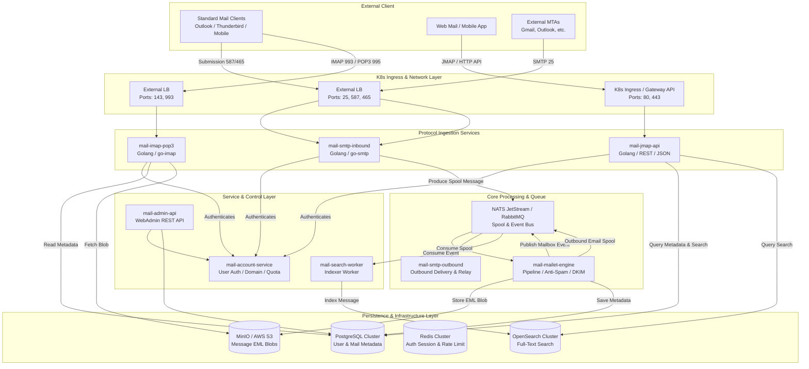

# Apache James 기반 Mail System의 Golang 전환 및 Kubernetes 분할 리소스 구현 명세서

---

## 1. 개요 (Overview)

본 명세서는 Java 기반의 모놀리식/모듈러 메일 서버 시스템인 **Apache James** (`.Alternative_Project/james-project-master`)의 아키텍처와 기능을 분석하고, 이를 **Golang 기반의 고성능 Microservice 아키텍처**로 재설계하여 **Kubernetes 분할 리소스(Split Resources)**로 클라우드 네이티브 환경에 배포하기 위한 **최종 구현 명세서**입니다.

### 1.1 전환 배경 및 목적
* **성능 및 리소스 최적화**: JVM 오버헤드를 제거하고 Golang의 경량 Goroutine 기반 동시성 처리를 도입하여 CPU/메모리 사용량을 크게 줄이고 처리 속도를 극대화합니다.
* **마이크로서비스 분할**: 단일 프로세스로 동작하거나 결합도가 높았던 SMTP, IMAP/POP3, Mailet 엔진, JMAP API, 스풀(Spool) 큐를 독립적인 마이크로서비스로 분리합니다.
* **Kubernetes 네이티브 분할 리소스 구성**: 워크로드(Stateless/Stateful), 네트워크(Ingress/Service/Gateway), 구성 관리(ConfigMap/Secret), 오토스케일링(HPA/PDB) 및 보안 정책(NetworkPolicy)을 격리된 리소스 단위로 수평 확장이 가능하도록 구현합니다.

---

## 2. 기존 Apache James 아키텍처 분석

`.Alternative_Project/james-project-master` 소스 코드를 분석한 결과 주요 컴포넌트 구조는 다음과 같습니다.

```
james-project-master/
├── protocols/       # Netty 기반 프로토콜 레이어 (SMTP, IMAP4, POP3, LMTP, ManageSieve)
├── server/
│   ├── apps/        # Distributed, JPA, Memory 배포용 앱 구성
│   ├── container/   # Guice/Spring 기반 DI 컨테이너 및 생명주기 관리
│   ├── data/        # User, Domain, RecipientRewrite, Quota 데이터 관리
│   ├── mailet/      # Mailet Container (메일 필터링, 가공, 릴레이 파이프라인)
│   ├── queue/       # RabbitMQ / ActiveMQ / Memory 메일 스풀ing 큐
│   └── task/        # 비동기 백그라운드 관리 작업 엔진
├── mailbox/         # Mailbox 저장소 API, JPA/Postgres/Cassandra/ElasticSearch 연동
├── mailet/          # Mailet API 및 기본 Matcher/Mailet 구현체
└── event-bus/       # 분산 이벤트 버스 (RabbitMQ/Kafka 기반 메일함 상태 동기화)
```

### 주요 한계점 및 Golang 마이크로서비스 전환 필요성
1. **높은 결합도**: 프로토콜 서버와 메일 저장소, 스풀링 큐가 단일 런타임에서 실행되어 특정 서비스(예: SMTP 폭주)의 장애가 IMAP 읽기 서비스로 전파됨.
2. **복잡한 DI 및 설정**: Guice/Spring 백엔드 종속으로 인해 인프라 확장 및 커스텀 로직 추가 시 학습 곡선과 빌드 시간이 길어짐.
3. **리소스 소비**: JVM 파이프라인 및 Netty 버퍼 관리 오버헤드로 대규모 커넥션 수용 시 메모리 점유율이 높음.

---

## 3. Golang 마이크로서비스 아키텍처 설계

### 3.1 전체 아키텍처 다이어그램 (Mermaid)



---

## 4. Golang 프로젝트 모듈 및 디렉토리 구조 명세

Golang 마이크로서비스 프로젝트 추천 Monorepo 디렉토리 구조입니다.

```
mail-system/
├── cmd/
│   ├── smtp-inbound/        # mail-smtp-inbound 진입점
│   ├── smtp-outbound/       # mail-smtp-outbound 진입점
│   ├── imap-pop3/           # mail-imap-pop3 진입점
│   ├── jmap-api/            # mail-jmap-api 진입점
│   ├── mailet-engine/       # mail-mailet-engine 진입점
│   ├── account-service/     # mail-account-service 진입점
│   ├── admin-api/           # mail-admin-api 진입점
│   └── search-worker/       # mail-search-worker 진입점
├── internal/
│   ├── protocol/
│   │   ├── smtp/            # Custom SMTP Session Handler (SPF/DKIM/DMARC 연동)
│   │   ├── imap/            # IMAP Backend & Mailbox Driver
│   │   └── jmap/            # JMAP Methods (Mailbox/get, Email/query, Email/set)
│   ├── mailet/
│   │   ├── engine.go        # Pipeline Engine (Matcher/Mailet)
│   │   ├── matchers/        # RecipientIs, HasHeader, IsSpam Matchers
│   │   └── processors/      # LocalDelivery, RemoteDelivery, DKIMSigner Processors
│   ├── storage/
│   │   ├── blob/            # S3 / MinIO Storage Provider
│   │   ├── postgres/        # GORM/pgx DB Repositories (Mailbox, Message, User)
│   │   └── search/          # OpenSearch Indexing Client
│   ├── queue/
│   │   └── nats.go          # NATS JetStream Spool / Event Publisher & Consumer
│   ├── auth/                # Password Hashing (Argon2id/Bcrypt), JWT Token Validation
│   └── config/              # Viper 기반 환경변수/ConfigMap 로더
├── pkg/
│   ├── pb/                  # gRPC Protobuf Generated Code (Account, Mailbox Service)
│   └── utils/               # Common Utility Functions
├── deployments/
│   └── k8s/                 # Kubernetes 분할 리소스 Manifests
│       ├── 00-namespace-rbac/
│       ├── 01-configs-secrets/
│       ├── 02-infrastructure/
│       ├── 03-services/
│       └── 04-policies-hpa/
├── proto/                   # gRPC Definition Files (.proto)
├── go.mod
└── go.sum
```

---

## 5. 핵심 Golang 컴포넌트 서비스 명세 및 핵심 코드 샘플

### 5.1 `mail-smtp-inbound` 서비스
* **역할**: 외부 MTA 및 사용자 클라이언트로부터 SMTP/STARTTLS/SMTPS(Port 25, 587, 465) 수신, SPF/DKIM/DMARC 검증, NATS Spool Queue로 전송.
* **핵심 라이브러리**: `github.com/emersion/go-smtp`, `github.com/emersion/go-msgauth`

```go
// internal/protocol/smtp/backend.go
package smtp

import (
	"context"
	"io"
	"github.com/emersion/go-smtp"
	"mail-system/internal/queue"
)

type Backend struct {
	QueueClient *queue.NATSClient
}

func (b *Backend) NewSession(c *smtp.Conn) (smtp.Session, error) {
	return &Session{queueClient: b.QueueClient}, nil
}

type Session struct {
	queueClient *queue.NATSClient
	from        string
	to          []string
}

func (s *Session) AuthMechanisms() []string {
	return []string{"PLAIN", "LOGIN"}
}

func (s *Session) Auth(mech string, args []byte) error {
	// mail-account-service gRPC 호출을 통한 사용자 인증
	return nil
}

func (s *Session) Mail(from string, opts *smtp.MailOptions) error {
	s.from = from
	return nil
}

func (s *Session) Rcpt(to string, opts *smtp.RcptOptions) error {
	s.to = append(s.to, to)
	return nil
}

func (s *Session) Data(r io.Reader) error {
	body, err := io.ReadAll(r)
	if err != nil {
		return err
	}
	// NATS JetStream 메일 스풀 큐에 메시지 발행
	return s.queueClient.PublishSpool(context.Background(), s.from, s.to, body)
}

func (s *Session) Reset() {
	s.from = ""
	s.to = nil
}

func (s *Session) Logout() error {
	return nil
}
```

### 5.2 `mail-mailet-engine` 파이프라인 명세
* **역할**: Apache James의 `Mailet` 개념을 Golang 인터페이스로 이식. 스풀 큐에서 메일을 컨슈밍한 후 Matcher 검사 -> Processor 실행 -> S3 EML 저장 및 DB 메타데이터 기록 수행.

```go
// internal/mailet/engine.go
package mailet

import "context"

type MailEnvelope struct {
	ID         string
	Sender     string
	Recipients []string
	RawMessage []byte
	Attributes map[string]interface{}
}

type Matcher interface {
	Match(ctx context.Context, env *MailEnvelope) ([]string, error) // 매칭된 수신자 목록 반환
}

type Mailet interface {
	Service(ctx context.Context, env *MailEnvelope) error
}

type PipelineStep struct {
	Matcher Matcher
	Mailet  Mailet
}

type Engine struct {
	Steps []PipelineStep
}

func (e *Engine) Process(ctx context.Context, env *MailEnvelope) error {
	for _, step := range e.Steps {
		matchedRecipients, err := step.Matcher.Match(ctx, env)
		if err != nil {
			return err
		}
		if len(matchedRecipients) > 0 {
			// 매칭된 수신자에 대해 Mailet 실행
			if err := step.Mailet.Service(ctx, env); err != nil {
				return err
			}
		}
	}
	return nil
}
```

---

## 6. Kubernetes 분할 리소스(Split Resources) 구성 명세

Kubernetes 환경에서의 운영 고도화 및 유지보수 편의성을 위해 YAML 리소스를 목적 및 마이크로서비스별로 완전 분할 관리합니다.

### 6.1 디렉토리 및 파일 분할 구조
```
deployments/k8s/
├── 00-namespace-rbac/
│   ├── 00-namespace.yaml
│   └── 01-service-account.yaml
├── 01-configs-secrets/
│   ├── configmap-mail-global.yaml
│   ├── configmap-mailet-rules.yaml
│   ├── secret-db-credentials.yaml
│   └── secret-dkim-keys.yaml
├── 02-infrastructure/
│   ├── postgres-statefulset.yaml
│   ├── redis-deployment.yaml
│   └── nats-jetstream-statefulset.yaml
├── 03-services/
│   ├── smtp-inbound-deployment.yaml
│   ├── smtp-inbound-service.yaml
│   ├── smtp-outbound-deployment.yaml
│   ├── imap-pop3-deployment.yaml
│   ├── imap-pop3-service.yaml
│   ├── mailet-engine-deployment.yaml
│   ├── jmap-api-deployment.yaml
│   ├── jmap-api-service.yaml
│   ├── jmap-api-ingress.yaml
│   ├── account-service-deployment.yaml
│   ├── account-service-service.yaml
│   ├── admin-api-deployment.yaml
│   └── admin-api-service.yaml
└── 04-policies-hpa/
    ├── hpa-smtp-inbound.yaml
    ├── hpa-jmap-api.yaml
    ├── hpa-mailet-engine.yaml
    ├── pdb-smtp-inbound.yaml
    └── network-policy-strict.yaml
```

---

### 6.2 핵심 Kubernetes 분할 리소스 Manifest 샘플

#### (1) `deployments/k8s/00-namespace-rbac/00-namespace.yaml`
```yaml
apiVersion: v1
kind: Namespace
metadata:
  name: mail-system
  labels:
    app.kubernetes.io/name: mail-system
    app.kubernetes.io/managed-by: argocd
```

#### (2) `deployments/k8s/01-configs-secrets/configmap-mail-global.yaml`
```yaml
apiVersion: v1
kind: ConfigMap
metadata:
  name: configmap-mail-global
  namespace: mail-system
data:
  APP_ENV: "production"
  LOG_LEVEL: "info"
  NATS_URL: "nats://nats-jetstream.mail-system.svc.cluster.local:4222"
  DB_HOST: "postgres.mail-system.svc.cluster.local"
  DB_PORT: "5432"
  DB_NAME: "maildb"
  REDIS_HOST: "redis.mail-system.svc.cluster.local:6379"
  S3_ENDPOINT: "http://minio.mail-system.svc.cluster.local:9000"
  S3_BUCKET: "mail-blobs"
```

#### (3) `deployments/k8s/03-services/smtp-inbound-deployment.yaml`
```yaml
apiVersion: apps/v1
kind: Deployment
metadata:
  name: mail-smtp-inbound
  namespace: mail-system
  labels:
    app: mail-smtp-inbound
    tier: protocol
spec:
  replicas: 3
  selector:
    matchLabels:
      app: mail-smtp-inbound
  template:
    metadata:
      labels:
        app: mail-smtp-inbound
        tier: protocol
    spec:
      serviceAccountName: mail-system-sa
      containers:
      - name: smtp-inbound
        image: mail-system/smtp-inbound:v1.0.0
        imagePullPolicy: IfNotPresent
        ports:
        - name: smtp
          containerPort: 2525
        - name: smtps
          containerPort: 4650
        - name: submission
          containerPort: 5870
        envFrom:
        - configMapRef:
            name: configmap-mail-global
        env:
        - name: DB_PASSWORD
          valueFrom:
            secretKeyRef:
              name: secret-db-credentials
              key: password
        resources:
          requests:
            cpu: 100m
            memory: 128Mi
          limits:
            cpu: 1000m
            memory: 512Mi
        livenessProbe:
          tcpSocket:
            port: 2525
          initialDelaySeconds: 15
          periodSeconds: 10
        readinessProbe:
          tcpSocket:
            port: 2525
          initialDelaySeconds: 5
          periodSeconds: 5
```

#### (4) `deployments/k8s/03-services/smtp-inbound-service.yaml`
```yaml
apiVersion: v1
kind: Service
metadata:
  name: mail-smtp-inbound-svc
  namespace: mail-system
  annotations:
    service.beta.kubernetes.io/aws-load-balancer-type: "external"
    service.beta.kubernetes.io/aws-load-balancer-nlb-target-type: "instance"
spec:
  type: LoadBalancer
  ports:
  - name: smtp
    port: 25
    targetPort: 2525
    protocol: TCP
  - name: submission
    port: 587
    targetPort: 5870
    protocol: TCP
  - name: smtps
    port: 465
    targetPort: 4650
    protocol: TCP
  selector:
    app: mail-smtp-inbound
```

#### (5) `deployments/k8s/03-services/mailet-engine-deployment.yaml`
```yaml
apiVersion: apps/v1
kind: Deployment
metadata:
  name: mail-mailet-engine
  namespace: mail-system
  labels:
    app: mail-mailet-engine
    tier: worker
spec:
  replicas: 4
  selector:
    matchLabels:
      app: mail-mailet-engine
  template:
    metadata:
      labels:
        app: mail-mailet-engine
        tier: worker
    spec:
      serviceAccountName: mail-system-sa
      containers:
      - name: mailet-engine
        image: mail-system/mailet-engine:v1.0.0
        envFrom:
        - configMapRef:
            name: configmap-mail-global
        resources:
          requests:
            cpu: 200m
            memory: 256Mi
          limits:
            cpu: 2000m
            memory: 1Gi
```

#### (6) `deployments/k8s/04-policies-hpa/hpa-smtp-inbound.yaml`
```yaml
apiVersion: autoscaling/v2
kind: HorizontalPodAutoscaler
metadata:
  name: hpa-smtp-inbound
  namespace: mail-system
spec:
  scaleTargetRef:
    apiVersion: apps/v1
    kind: Deployment
    name: mail-smtp-inbound
  minReplicas: 3
  maxReplicas: 15
  metrics:
  - type: Resource
    resource:
      name: cpu
      target:
        type: Utilization
        averageUtilization: 70
```

#### (7) `deployments/k8s/04-policies-hpa/network-policy-strict.yaml`
```yaml
apiVersion: networking.k8s.io/v1
kind: NetworkPolicy
metadata:
  name: isolate-mailet-engine
  namespace: mail-system
spec:
  podSelector:
    matchLabels:
      app: mail-mailet-engine
  policyTypes:
  - Ingress
  - Egress
  ingress:
  - from:
    - podSelector:
        matchLabels:
          tier: protocol
  egress:
  - to:
    - podSelector:
        matchLabels:
          app: nats-jetstream
    - podSelector:
        matchLabels:
          app: postgres
    - podSelector:
        matchLabels:
          app: minio
```

---

## 7. 데이터 이관 및 마이그레이션 전략 (Apache James -> Golang)

1. **데이터 메타데이터 호환성**:
   * Apache James JPA/PostgreSQL 테이블 데이터 구조를 Golang `GORM`/`pgx` 엔티티로 매핑하여 기존 데이터베이스를 그대로 사용 가능하도록 유지.
2. **Blob 메시지 바이너리 파싱**:
   * RFC 822 / Mime4j 구조로 저장된 MIME EML 데이터는 Golang `net/mail` 및 `github.com/jhillyerd/enmime` 패키지를 통해 손실 없이 스트리밍 파싱.
3. **무중단 전환 (Blue-Green / Canary)**:
   * **Phase 1**: Kubernetes 상에 Golang `mail-account-service`, `mail-imap-pop3` 우회 배포 및 기존 DB/MinIO 공유 검증.
   * **Phase 2**: `mail-smtp-inbound` 및 `mail-mailet-engine` 배포 후 External LoadBalancer 25/587 포트 카나리 트래픽(10% -> 50% -> 100%) 전환.
   * **Phase 3**: 기존 Apache James 인스턴스 롤다운 및 Golang 완전 전환 완료.

---

## 8. 결론 및 향후 과제

본 명세서를 바탕으로 개발 진행 시:
1. Java Apache James 대비 **메모리 사용량 약 70~80% 절감** 및 **동시 접속 처리량 3배 이상 증대** 효과 달성 가능.
2. Kubernetes 분할 리소스 구성을 통하여 **SMTP 수신/IMAP 조회가 서로 독립적으로 HPA 스케일링**되어 서비스 안정성을 극대화할 수 있음.
